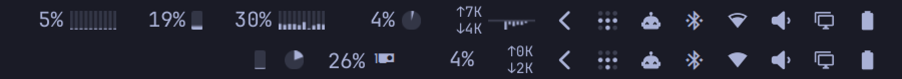

# Gauges for Omarchy

CPU, memory, GPU, disk and network readings in the Omarchy bar. Each one opens a detail
panel in the style of Omarchy's own battery and display panels, and follows
whatever theme is active.


Each reading can be drawn as a graph, a gauge, a pie, a number or an icon:



- **CPU**: load, two minutes of history, per-core bars, temperature, load
  average, uptime, and the programs using the most processor.
- **Memory**: used and cached memory, history, swap, and the programs holding
  the most memory.
- **GPU**: load for each card, with video memory, temperature and power
  where the card reports them.
- **Disk**: space on each volume, read and write activity, and drive
  temperature.
- **Network**: download and upload speed, history, the programs using the
  network most, and each interface's speed and traffic since startup.

Requires Omarchy 4.5 or later.

## Install

```bash
omarchy plugin add https://github.com/azizuysal/omarchy-gauges.git --enable
```

Update with `omarchy plugin update azizuysal.gauges`, remove with
`omarchy plugin remove azizuysal.gauges`.

## Use

| Action | Result |
|---|---|
| Click a reading | Open its panel; click again to close |
| Right-click | Open btop |
| Left / Right in a panel | Step through the readings |
| Tab | Move to the next bar panel |
| Esc | Close |

Drag the widget along the bar to move it, or use `omarchy bar move azizuysal.gauges --section right`.

### Settings

Set these in the shell's settings panel, or with
`omarchy bar set azizuysal.gauges <key> <value>`. They are stored with the
rest of the bar layout in `~/.config/omarchy/shell.json`.

| Key | Default | Meaning |
|---|---|---|
| `cpu` | `Graph` | How processor load is shown |
| `memory` | `Gauge` | How memory in use is shown |
| `gpu` | `Graph` | How graphics load is shown |
| `disk` | `Pie` | How space on the system disk is shown |
| `network` | `Graph` | How network traffic is shown: `Graph`, `Rates`, `Icon` or `Off` |
| `showPercentage` | `false` | Put the number beside graphs, gauges and pies |
| `warnAt` | `90` | Memory and disk turn the warning colour when this full (%) |

CPU, memory, GPU and disk each take one of these styles:

| Style | What it draws |
|---|---|
| `Graph` | The last ten readings as a bar graph. For disk this is read and write activity, since free space hardly moves. |
| `Gauge` | An upright gauge filling from the bottom. Memory's shows cache as a fainter band. |
| `Pie` | A pie of the current level |
| `Percentage` | The number alone |
| `Icon` | The icon alone |
| `Icon and percentage` | Both |
| `Off` | Leaves the reading out of the bar |

The network has speeds, not a level, so its styles are its own: `Graph`
draws recent upload above a middle line and download below it, both scaled
to the busiest moment in view; `Rates` shows the two speeds as numbers.

```bash
omarchy bar set azizuysal.gauges memory Graph
omarchy bar set azizuysal.gauges gpu Off
omarchy bar set azizuysal.gauges showPercentage true --json
```

Hovering a reading that shows no number gives its percentage. On a vertical
bar every reading is shown as its icon.

The widget can be added to the bar more than once, each copy with its own
settings, to place readings in different parts of the bar: turn the readings
a copy should not show to `Off`.

### Keybindings

`omarchy-shell gauges show <reading>` opens a panel directly, and
`omarchy-shell gauges toggle` toggles the last one. For example, in
`~/.config/hypr/bindings.lua`:

```lua
o.bind("SUPER CTRL, M", "System monitor", "omarchy-shell gauges toggle")
```

## Naming every program on the network (optional)

Seeing which program is behind each byte of traffic means watching packets,
which Linux does not let an ordinary user do. One command sets that up:

```bash
sudo ~/.config/omarchy/plugins/azizuysal.gauges/nethogs-setup
```

It installs `nethogs` if it is missing, gives it the capabilities to capture
packets without root, and adds two pacman hooks
(`/etc/pacman.d/hooks/gauges-nethogs-capabilities.hook` and
`gauges-nethogs-capabilities-check.hook`) that restore them whenever
`nethogs` is updated, since an update would otherwise drop them.

Afterwards any user on the machine can run `nethogs` and see which programs
are talking on the network.

The script follows an all-or-nothing rule, so it never mixes its settings
with an administrator's:

- It gives `nethogs` capabilities only when `nethogs` has none, and then
  exactly the four it needs. If `nethogs` already has any, it stops, changes
  nothing and tells you what the panel needs.
- It notes that it did so in `/var/lib/gauges/nethogs-capabilities.set`,
  written before the capabilities are granted.
- After a `nethogs` update, its hook grants them again only if that note is
  still there and the new file has no capabilities. A second hook runs
  before the update and drops the note if the capabilities are no longer
  exactly the ones the script granted, so a change you made by hand is never
  undone by an update.
- Hook files of those names that the script did not write are left alone
  (setup stops instead of overwriting them).

Undo it with `sudo nethogs-setup --remove`. It clears the capabilities only
if they are exactly the set the script granted and its note is there;
otherwise it leaves them alone and prints the command to clear them
yourself. It then deletes its hooks and its note. If clearing fails it stops
with an error and keeps both, so it can be run again. On a machine that
never ran setup it changes nothing.

If you ran setup with Gauges 1.0.0, run it once more after updating. That
version's hook granted the capabilities again after every `nethogs` update
regardless of what had been done to them since, and left no note. The new
script will not touch capabilities it has no note for, but it does remove
that old hook. To hand the capabilities over to it afterwards:
`sudo setcap -r "$(realpath "$(command -v nethogs)")"`, then run setup again.

## What the bar shows

| Reading | By default | Value | Turns the warning colour |
|---|---|---|---|
| CPU | Graph | Share of processor time in use | Never |
| Memory | Gauge | Memory programs hold, not counting cache | At `warnAt` |
| GPU | Graph | Load of the busiest card that reports it | Never |
| Disk | Pie | Space used on the root filesystem | At `warnAt` |
| Network | Graph | Upload and download speed over the last minute | Never |

The GPU item is left out on a machine whose graphics report no load.

## Hardware support

CPU load, memory, disk and network come from `/proc` and work on any machine Omarchy
runs on, x86 or ARM, real or virtual. Temperature and graphics depend on what
the hardware's drivers publish:

| Machine | CPU temperature | GPU |
|---|---|---|
| Intel or AMD processor | Yes | See graphics below |
| Apple Silicon | No: the kernel exposes no processor sensor | No load figure, so no GPU item |
| Qualcomm Snapdragon | Hottest of the per-core sensors | Load |
| NVIDIA N1x, GB10 | If a processor thermal zone exists | Load, temperature and power through `nvidia-smi` |
| Virtual machine | No | Only with a virtual card that reports usage |

| Graphics | What is shown |
|---|---|
| AMD | Load, video memory, temperature, power |
| Intel (`i915`, `xe`) | Load and frequency |
| NVIDIA | Load, video memory, temperature, power, through `nvidia-smi` |
| Qualcomm Adreno, Arm Mali and other ARM graphics | Load, where the driver reports usage per program |
| Apple | Listed in the panel, without load |

**Tested on real hardware:** one Intel laptop with Intel and AMD graphics.
Everything else in these tables was written from kernel sources and is
exercised only by tests against made-up machines (`tests/sample.test.js`).
Reports from other hardware are very welcome.

- Where a driver gives no load figure for the card as a whole (Intel, and
  ARM graphics), the load is added up from the usage each program reports in
  `/proc/<pid>/fdinfo`. Only your own programs are visible, so graphics work
  done by another user's processes is not counted.
- The network panel's list of programs comes from
  [nethogs](https://github.com/raboof/nethogs) once you have run the setup
  below, and then covers every program and both TCP and UDP. Without it the
  list is limited to the TCP connections of your own programs, which misses
  UDP traffic such as video calls and much of a browser's. Either way it is
  read only while the network panel is open.
- Network speed counts interfaces with a real device behind them, so VPN
  and loopback traffic is not counted twice.
- A discrete card that is powered down is shown as asleep and left alone,
  since reading its sensors would wake it.
- On ARM the panel names the machine ("Apple MacBook Air (M1, 2020)") where
  x86 names the processor, as `/proc/cpuinfo` carries no model name there.
- Drive temperature comes from `nvme` or `drivetemp`, and is read only while
  the disk panel is open, and then every 30 seconds. Asking a drive for it
  continuously made the keyboard and trackpad stutter on an Apple T2 laptop,
  where they share a controller.

## How it works

`sample.sh` streams raw counters from `/proc` and `/sys` every two seconds
using only bash builtins, so a sample costs no process launches. `Service.qml`
runs it once for the whole shell, however many monitors show the bar, and
`Model.js` turns the counters into readings. The process list (`top`) only
runs while a CPU or memory panel is open, and drive temperature is only read
while the disk panel is open.

## Development

```bash
./dev-install --restart   # copy into ~/.config/omarchy/plugins and reload
./dev-install --remove    # take it out again
node --test tests/        # parsing, arithmetic, and made-up-machine tests
omarchy plugin validate . # manifest check
```

Translations live in `i18n/`, one JSON file per Omarchy language code;
anything missing falls back to `en.json`.

## License

MIT
